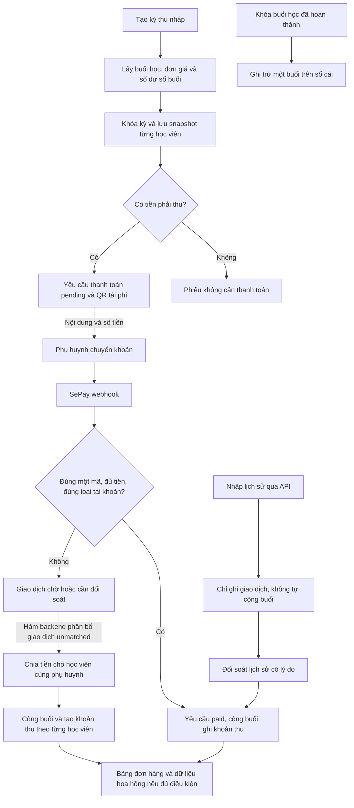

# Rà soát nghiệp vụ học phí và SePay

Ngày: 23/09/2026. Mã nguồn tại HEAD `87e59ad`, có thay đổi payroll ngoài phạm vi rà soát.

**Kết luận:** nền tảng đã có luồng thu đúng mã/đúng tiền, snapshot kỳ thu, sổ cái số buổi và bảng đơn hàng. Phần cần hoàn thiện trước khi mở rộng tự động hóa là ranh giới kỳ thu, xử lý ngoại lệ thanh toán, liên kết phân bổ với công nợ, và vòng đời phiếu thay thế.

**Nghiệp vụ đã được người dùng xác nhận:** thu trước theo lịch học của kỳ, bù số buổi thừa/thiếu kỳ trước. Các phương án dưới đây lấy mô hình này làm chuẩn.

Phạm vi bằng chứng: đọc mã giao diện, server actions, chuỗi migration và test; chạy 62 test unit/component liên quan, đều đạt. Chưa kiểm tra DB production, cấu hình tài khoản SePay thực tế hoặc thực hiện chuyển tiền. Docker local không hoạt động nên chưa chạy pgTAP. Vì vậy, “hiện tại” trong báo cáo là hành vi của mã nguồn nếu các migration tương ứng đã được triển khai. Những ví dụ rủi ro là suy luận từ code, không phải kết luận đã xảy ra sai lệch tiền thật.

Đã sử dụng gstack router. Script khởi động không có ở đường dẫn mà skill cấu hình; bản script có trong cây `.agents/skills/gstack/bin`. Rà soát tiếp tục ở chế độ suy giảm, không sửa cài đặt, không chạy một vòng plan-eng-review tương tác hoặc cross-model review. Ảnh người dùng cung cấp chỉ là tham khảo giao diện, không được coi là quy định học phí/chi phí vận hành.

## 1. Luồng đang có

### Kỳ thu và phiếu học phí

1. Tạo kỳ với ngày đầu, ngày cuối, hạn thanh toán và mẫu phiếu.
2. Preview dựa vào **các buổi học đã được tạo trong hệ thống**, không tự suy diễn toàn bộ lịch từ mẫu lịch tuần. Bao gồm buổi thường chưa hủy; buổi bù được tính khi buổi gốc đã hủy. Roster có hỗ trợ lớp thành phần và lịch sử hiệu lực ghi danh.
3. Lấy giá có hiệu lực vào ngày từng buổi; lấy nguồn học viên; lấy số dư tổng hợp từ sổ cái số buổi.
4. Khi khóa: bù số dư dương vào các buổi theo thứ tự ngày; số dư âm được cộng thành dòng thiếu buổi với đơn giá buổi đầu trong kỳ. Tạo snapshot chi tiết, nguồn, mẫu phiếu và tài khoản nhận.
5. Số tiền bằng 0: tạo phiếu `no_payment`, không tạo yêu cầu/QR. Số tiền lớn hơn 0: tạo yêu cầu `pending`, loại `renewal`, QR chứa số tiền và mã chuyển khoản riêng.
6. Khóa lại **cùng một kỳ** không tạo thêm yêu cầu. Snapshot kỳ khóa được bảo vệ khỏi sửa/xóa.

Điểm tốt cần giữ: đơn giá theo hiệu lực, chi tiết nhiều mức giá trên cùng phiếu, snapshot QR, ghi nhật ký và xử lý khóa trong một transaction.

Nguồn: [preview hiện hành](/Users/linhtran/Documents/ERP-Toan-Thay-Vinh/toan-thay-vinh-erp-app/supabase/migrations/20260817094500_class_component_roster_tuition_history.sql:37), [khóa kỳ](/Users/linhtran/Documents/ERP-Toan-Thay-Vinh/toan-thay-vinh-erp-app/supabase/migrations/20260814100000_tuition_collection_wave_a.sql:380).

### Thu thành công bằng webhook

Endpoint kiểm tra chữ ký, payload và tài khoản nhận theo danh mục có ngày hiệu lực. Sau đó DB lưu webhook, nhận diện giao dịch ngân hàng và chống xử lý trùng. Tài khoản được phân loại tuyển mới/tái phí/chưa xác định.

Chỉ tự hoàn tất khi giao dịch tiền vào, tài khoản được nhận diện, khớp duy nhất một yêu cầu đang `pending`, có học viên, đúng loại tuyển mới/tái phí và **số tiền bằng chính xác** yêu cầu.

Trong cùng giao dịch DB, hệ thống:

- Chuyển yêu cầu sang `paid`, lưu tiền và thời điểm ngân hàng.
- Tạo lô số buổi (`student_credit_lots`).
- Ghi `payment_credit` và `bonus_credit` nếu có vào sổ cái số buổi.
- Ghi khoản thu học phí (`finance_cashflow_records`).
- Đánh dấu giao dịch `auto_matched`.

HTTP 200 của webhook chỉ cho biết đã tiếp nhận/xử lý thông báo thành công ở cấp API; giao dịch có thể vẫn cần đối soát nghiệp vụ. Không dùng HTTP 200 làm bằng chứng học phí đã được phân bổ.

Nguồn: [endpoint](/Users/linhtran/Documents/ERP-Toan-Thay-Vinh/toan-thay-vinh-erp-app/src/app/api/webhooks/sepay/route.ts:35), [logic settlement hiện hành](/Users/linhtran/Documents/ERP-Toan-Thay-Vinh/toan-thay-vinh-erp-app/supabase/migrations/20260905010000_sepay_api_v2_record_only_ingestion.sql:412).

### Chuyển tiền không có yêu cầu thanh toán

Nếu webhook đến được ERP, tiền được lưu thành giao dịch `unmatched`; chưa tạo khoản thu học phí, chưa cộng buổi, chưa xuất hiện thành đơn hàng đã thu.

Backend `allocate_payment_to_students` cho phép phân bổ cho một hoặc nhiều học viên thuộc cùng một phụ huynh, với các ràng buộc: tiền vào, mục đích tài khoản đã rõ, giao dịch `unmatched`, mỗi học viên xuất hiện một lần và tổng phân bổ bằng toàn bộ giao dịch. Nó tạo lô buổi, sổ cái và khoản thu theo từng học viên.

**Giới hạn thực tế:** có server action nhưng không thấy component/route gọi `allocatePaymentAction`; chưa có màn hình vận hành hoàn chỉnh cho nhánh này. Hàm phân bổ cũng không nhận `payment_request_id`, không thanh toán các yêu cầu đang chờ của học viên và không giữ lại tiền dư chưa phân bổ.

Nguồn: [phân bổ hiện hành](/Users/linhtran/Documents/ERP-Toan-Thay-Vinh/toan-thay-vinh-erp-app/supabase/migrations/20260905020000_sepay_history_sync_workflow.sql:849), [server action](/Users/linhtran/Documents/ERP-Toan-Thay-Vinh/toan-thay-vinh-erp-app/src/features/finance/actions/finance-actions.ts:217).

### Nhập giao dịch lịch sử

API v2 chỉ ghi nhận giao dịch; không tự tạo học phí hay buổi. Giao dịch đã nhập qua API cũng không được tự settlement bởi webhook đến sau. Đối soát lịch sử có ba lựa chọn: khớp yêu cầu đủ điều kiện; đánh dấu đã hạch toán trước đây; bỏ qua có lý do. Hai lựa chọn sau không tạo tiền/buổi mới.

Cơ chế nhận diện chung cố gắng gộp webhook/API, có khóa và trạng thái xung đột. Đây là nền tảng cần giữ khi tự động bù giao dịch bị thiếu.

### Đơn hàng, chi phí vận hành và số buổi

“Đơn hàng” hiện là dữ liệu tổng hợp từ **khoản thu học phí đã gắn SePay và học viên**, không phải một chứng từ bán hàng độc lập được tạo trước thanh toán. Một giao dịch chia cho hai học viên sinh hai dòng đơn hàng. Yêu cầu còn chờ và tiền chưa phân bổ chưa nằm trong bảng này.

Bảng có thông tin học viên, lớp, phụ huynh, sale, nguồn, tiền thu, nội dung chuyển khoản, chi phí vận hành, đợt 1/2/3 và xác nhận đã kiểm tra. Đợt lần lượt là ngày 1–10, 11–20 và phần còn lại của tháng theo giờ Việt Nam. Nguồn/sale phụ thuộc vào dữ liệu accrual từ CRM đủ điều kiện.

Các công thức đang có: SB tuyển mới = 700.000 + 25% tiền học; SB tái phí = 20%; MMA tái phí = 0; SB F1 và các trường hợp chưa định nghĩa trả “chưa cấu hình”. Công thức được gọi lúc đọc báo cáo. Nút check chỉ lưu dấu đã kiểm tra và audit, chưa là một phiên quyết toán khóa sổ hay bằng chứng đã chi tiền.

Sổ cái số buổi cộng khi học phí được ghi nhận. Khi khóa buổi đã hoàn thành, hiện cả đi học, nghỉ có phép và nghỉ không phép đều trừ một buổi đối với buổi thường/bù; có quy trình ghi bút toán đảo cộng lại một buổi. Cần công bố rõ quy tắc nghỉ/bù này cho phụ huynh. `remaining_sessions` của lô buổi chưa có cơ chế tiêu thụ đồng bộ trong các migration đã rà; số dư vận hành hiện lấy từ tổng sổ cái.

Nguồn: [đơn hàng](/Users/linhtran/Documents/ERP-Toan-Thay-Vinh/toan-thay-vinh-erp-app/supabase/migrations/20260813170000_extend_finance_orders_dashboard_details.sql:7), [công thức và check](/Users/linhtran/Documents/ERP-Toan-Thay-Vinh/toan-thay-vinh-erp-app/supabase/migrations/20260813160000_finance_orders_and_sepay_account_purposes.sql:823), [khóa buổi](/Users/linhtran/Documents/ERP-Toan-Thay-Vinh/toan-thay-vinh-erp-app/supabase/migrations/20260817090000_class_component_roster_foundation.sql:223).

## 2. Những vấn đề cần ưu tiên

P1: có thể làm sai công nợ/số buổi hoặc khiến tiền không xử lý được trong luồng thông thường. P2: ảnh hưởng kiểm soát và hiệu suất vận hành. Đây là mức ưu tiên đề xuất, chưa phải đánh giá tổn thất production.

| Mức | Phát hiện có căn cứ trong code | Tác động và cách xử lý đề xuất |
|---|---|---|
| P1 | Số “dư đầu kỳ” lấy tổng sổ cái hiện tại, không có cutoff theo kỳ; khóa chỉ khóa row của kỳ | Khóa muộn có thể tính cả buổi đã trừ của chính kỳ đó; tạo kỳ khác có thể dùng lại số dư. Cần số dư chốt kỳ trước, phân biệt quyền học đã dành cho kỳ nào và khóa chống dùng chung số dư. |
| P1 | Không có ràng buộc chống thu cùng học viên/buổi ở các kỳ chồng nhau | Cùng buổi có thể xuất hiện trong nhiều phiếu đang hiệu lực. Thêm định danh nghĩa vụ thu theo học viên/buổi/loại phí, có ngoại lệ thay thế minh bạch. |
| P1 | Phát hành lại tạo yêu cầu mới nhưng không hủy/thay thế yêu cầu cũ hoặc kiểm tra tiền đã trả | Phiếu cũ vẫn có thể khớp tiền; yêu cầu cũ và mới cùng bị tính công nợ. Cần vô hiệu hóa việc thu mới trên bản cũ bằng quan hệ thay thế, xử lý khoản đã trả và chuyển tham chiếu QR cũ vào hàng chờ. |
| P1 | `amount_mismatch`, `account_purpose_mismatch` không được phép phân bổ; dialog chỉ mở cho giao dịch có SePay v2 ID và trạng thái unmatched/conflict | Tiền thiếu/thừa, sai tài khoản hoặc sai mã trên webhook có thể kẹt. Cần một bộ xử lý ngoại lệ chung cho webhook lẫn lịch sử. |
| P1 | Phân bổ không liên kết yêu cầu thu; server action chưa có nơi gọi ở UI | Có thể cộng buổi/ghi tiền mà công nợ cũ vẫn còn. Xây màn hình phân bổ vào phiếu hoặc khoản trả trước, không yêu cầu nhập lại số buổi tùy ý. |
| P2 | Kỳ khóa và trang phiếu đọc status snapshot, không nối trạng thái thanh toán; QR vẫn hiển thị ở phiếu đã trả/bản cũ | Nhân viên có thể nhắc nhầm; phụ huynh có thể chuyển lại. Giữ snapshot nguyên vẹn, thêm trạng thái hiện hành được tính từ yêu cầu/phân bổ/thay thế. |
| P2 | Schema có `partially_paid` nhưng webhook/manual match chỉ nhận đủ tiền và `pending` | Chưa có quy trình trả nhiều lần. Bổ sung quan hệ nhiều giao dịch ↔ nhiều phiếu, tổng tiền đã áp dụng và số dư còn phải thu. |
| P2 | Đơn giá phân bổ cho phép caller truyền vào, khác nguyên tắc hàm tạo yêu cầu tự tính giá; lô buổi chưa được tiêu thụ theo từng lần học | Dễ lệch tiền/buổi và thiếu căn cứ hoàn phí. Lấy điều khoản từ phiếu/dòng giá, kiểm soát giảm/tặng riêng; thêm tiêu thụ lô khi cần định giá phần chưa học. |
| P2 | Quy tắc chi phí vận hành được tính lại theo hàm hiện hành; check chưa khóa dữ liệu quyết toán | Thay công thức có thể thay số lịch sử. Lưu phiên bản chính sách và kết quả khi xác nhận; có phiên quyết toán, điều chỉnh và liên kết chứng từ chi. |
| P2 | Ngày ngân hàng/ngày ghi sổ/ngày buổi chưa thống nhất hoàn toàn | Đơn hàng dùng transaction_at; cashflow mặc định ngày insert, trigger chỉ sửa cho dữ liệu có API history. Webhook cộng buổi dùng cast date phụ thuộc timezone DB. Cần trường received_at, posted_at, business_date rõ ràng và quy tắc cutoff giờ Việt Nam. |

Các ví dụ cụ thể để nghiệm thu:

- **Khóa muộn:** đầu tháng có 0 buổi, tháng có 8 buổi; đã khóa học 3 buổi nên tổng hiện tại -3. Công thức hiện hành có thể tạo 11 buổi phải trả cho tháng có 8 buổi. Cần tách thiếu từ kỳ trước và tiêu thụ của kỳ đang thu.
- **Kỳ trước chưa trả:** đã có phiếu nợ 8 buổi, học xong thành -8 buổi; kỳ sau lại cộng 8 buổi âm vào phiếu mới trong khi phiếu cũ vẫn chờ. Cần chuyển/hiển thị nợ cũ bằng tham chiếu, không tạo nghĩa vụ mới cho cùng khoản nợ.
- **Phát hành lại:** phiếu 1.200.000 điều chỉnh thành 900.000. Hiện hai yêu cầu có thể cùng pending. Trạng thái đúng phải chỉ còn nghĩa vụ thu hiệu lực 900.000, có xử lý riêng nếu trước đó đã nhận tiền.
- **Chuyển nhiều lần:** 1.200.000 trả thành 700.000 rồi 500.000. Hiện mỗi lần khác số yêu cầu nên không tự hoàn tất. Luồng mới phải giữ được 700.000 đã nhận và chốt khi đủ 1.200.000.
- **Chuyển dư:** nhận 1.300.000 cho phiếu 1.200.000. Cần 1.200.000 thanh toán phiếu + 100.000 trả trước/chờ hoàn, không tự biến toàn bộ phần dư thành số buổi.

Nguồn bổ sung: [view tổng số dư](/Users/linhtran/Documents/ERP-Toan-Thay-Vinh/toan-thay-vinh-erp-app/supabase/migrations/20260726121832_session_ledger_foundation.sql:643), [phát hành lại](/Users/linhtran/Documents/ERP-Toan-Thay-Vinh/toan-thay-vinh-erp-app/supabase/migrations/20260814100000_tuition_collection_wave_a.sql:328), [điều kiện mở đối soát](/Users/linhtran/Documents/ERP-Toan-Thay-Vinh/toan-thay-vinh-erp-app/src/features/finance/components/sepay-reconciliation-dialog.tsx:44), [công nợ dashboard](/Users/linhtran/Documents/ERP-Toan-Thay-Vinh/toan-thay-vinh-erp-app/src/features/dashboard/data.ts:308), [dữ liệu kỳ khóa](/Users/linhtran/Documents/ERP-Toan-Thay-Vinh/toan-thay-vinh-erp-app/src/features/tuition/data.ts:103).

Hoàn phí hiện bị vô hiệu hóa chủ động: RPC trả `REFUND_WORKFLOW_NOT_AVAILABLE` và component không hiển thị. Không nên mở lại trước khi có căn cứ số buổi đã tiêu thụ, số tiền có thể hoàn và bút toán đảo. [Nguồn](/Users/linhtran/Documents/ERP-Toan-Thay-Vinh/toan-thay-vinh-erp-app/supabase/migrations/20260806100000_fix_production_data_workflows.sql:820).

## 3. Mô hình vận hành đề xuất

### 3.1. Một nghĩa vụ thu, nhiều cách thanh toán

Tách rõ năm đối tượng trong nghiệp vụ và giao diện:

| Đối tượng | Trả lời câu hỏi |
|---|---|
| Phiếu học phí/đơn thu | Học viên phải trả bao nhiêu, cho kỳ nào, dựa trên buổi và đơn giá nào? |
| Yêu cầu thanh toán/QR | Phụ huynh dùng mã gì, tài khoản nào để thanh toán nghĩa vụ đó? |
| Giao dịch ngân hàng | Tiền thực sự đến bao nhiêu, ngày nào, tài khoản nào? |
| Phân bổ thanh toán | Bao nhiêu của giao dịch này đã trả cho từng phiếu hoặc giữ trả trước? |
| Sổ cái quyền học | Học viên được cộng, đã dùng, được trả lại bao nhiêu buổi, từ căn cứ nào? |

Màn hình đơn hàng có thể là màn hình tổng hợp của các đối tượng trên. Không cần tạo một bản sao doanh thu độc lập rồi nhập lại cùng một khoản tiền.

Đề xuất thêm trạng thái phiếu: chưa thu, thu một phần, đã đủ, thay thế/hủy; trạng thái quá hạn tính từ hạn trả và số còn thiếu. Giao dịch có trạng thái riêng: chưa xác định, chờ phân bổ, phân bổ một phần, đã phân bổ, chờ hoàn, đã xử lý ngoại lệ. Check kế toán và trạng thái quyết toán là hai trục khác.

### 3.2. Chốt kỳ thu trước có đối chiếu

1. Tạo đầy đủ buổi học của kỳ mới và hoàn tất điểm danh/khóa buổi kỳ trước.
2. Chốt số dư tại ranh giới kỳ với timestamp và tập dữ liệu nguồn. Nếu khóa sau ngày đầu kỳ, tái dựng đúng cutoff; nếu thu sớm trước khi kỳ trước kết thúc, ghi phần tạm tính và đối chiếu sau. Không dùng tổng số dư hôm nay làm số dư đầu kỳ.
3. Tách số buổi dư đã trả tiền, buổi tặng, thiếu buổi chưa lập nghĩa vụ thu và công nợ đã có phiếu. Khoản trả trước cho kỳ tương lai cần gắn kỳ/phân bổ, không được dùng lặp cho nhiều kỳ.
4. Preview hiển thị số buổi kỳ mới, bù trừ, dòng nợ cũ có tham chiếu, mức giá, tổng cần thu và các điều kiện còn thiếu.
5. Khóa tạo một bộ phiếu hiệu lực; phát hành QR; lưu lịch sử gửi/nhắc. Điều chỉnh sau khóa tạo chứng từ điều chỉnh, giữ quan hệ với phiếu và tiền đã nhận.

Ví dụ cùng giá 150.000/buổi: kỳ mới 8 buổi, còn dư hợp lệ 2 buổi → thu thêm 6 buổi = 900.000. Thiếu 1 buổi từ kỳ trước **chưa có phiếu ghi nhận** → 9 buổi = 1.350.000. Nếu 1 buổi đó đã thuộc phiếu nợ cũ, hiển thị nợ cũ và phân bổ tiền về phiếu cũ, không lập nợ trùng.

Khi giá đổi, khoản nợ tiền đã xác lập giữ giá gốc. Quyền học dư được bù theo buổi hay theo giá trị là chính sách sản phẩm cần ghi rõ; với mô hình người dùng chọn, đề xuất giữ quyền học theo buổi trong cùng chương trình, còn chuyển sang lớp/chương trình khác đơn giá phải có quy tắc quy đổi có phiên bản. Không định giá lại nợ cũ bằng đơn giá đầu kỳ mới.

### 3.3. Nhận tiền và xử lý ngoại lệ

| Tình huống | Hành vi đề xuất |
|---|---|
| Đúng mã, đủ tiền | Tự áp dụng vào phiếu; sinh khoản thu và quyền học đúng một lần; đưa vào đơn hàng đã thu. |
| Trả thiếu hoặc trả nhiều lần | Cộng dồn phân bổ; cập nhật phần còn thiếu. Quyền học chỉ được cấp theo chính sách đã xác định, không làm tròn tùy ý từ tiền lẻ. |
| Chuyển thừa | Đủ phiếu thì đóng phiếu; dư vào số tiền trả trước của gia đình, có lựa chọn phân bổ kỳ sau/hoàn. |
| Không có yêu cầu | Vào hàng chờ tiền nhận; nhận diện gia đình; ưu tiên phiếu đang nợ; nếu chưa có nghĩa vụ thu thì giữ trả trước hoặc lập phiếu thu có căn cứ. |
| Một giao dịch cho hai con | Một giao dịch gốc, hai hoặc nhiều dòng phân bổ vào các phiếu của từng con; tổng không vượt tiền nhận. |
| Sai tài khoản tuyển mới/tái phí nhưng tiền đã vào tài khoản của trung tâm | Cho kế toán xác minh và phê duyệt mục đích nghiệp vụ; giữ nguyên tài khoản thực nhận; ghi lý do. Không suy mục đích đơn hàng duy nhất từ tài khoản. |
| Nội dung mơ hồ | Gợi ý theo mã học viên/gia đình, phiếu nợ, số tiền; tên hoặc số tiền đơn lẻ không đủ để tự ghi học phí. |
| Chuyển lại mã của phiếu đã trả/đã thay thế | Đưa vào hàng chờ “nghi trả trùng/QR cũ”; không tự cộng thêm gói buổi. |
| Tiền không phải học phí | Phân loại có lý do, người xử lý và chứng từ; không dùng một nút bỏ qua để che khoản chưa giải thích. |
| Dữ liệu lịch sử | Giữ chế độ chỉ ghi nhận; yêu cầu quyết định có audit, bảo vệ kỳ đã chốt và chống hạch toán lại. |

Với mô hình thu trước, nên quản lý nghĩa vụ thu và quyền học độc lập. Trả thiếu có thể vẫn cho học theo hạn mức công nợ được duyệt; trạng thái học không nên bị quyết định ngầm bởi phép chia số tiền/số buổi. Phần tiền chưa đủ cho một đơn vị quyền học được giữ bằng VND. Khi hoàn tất thanh toán, chỉ cộng phần quyền học chưa cấp trước đó.

Quy tắc bảo toàn cần có ở DB: tiền nhận = tổng tiền đã áp dụng + tiền trả trước/chờ xử lý + tiền đã hoàn hoặc phân loại hợp lệ; mọi khoản tiền chỉ được tính vào một nhóm tại một thời điểm. Hoàn tiền phải có giao dịch chi/biên nhận tham chiếu. Không tạo khoản thu lần thứ hai chỉ vì chuyển từ tiền trả trước sang thanh toán phiếu.

### 3.4. Đối soát đơn hàng theo ảnh tham khảo

Giữ các yếu tố hữu ích trong ảnh: nhóm theo đợt, tổng học phí/chi phí, lọc nguồn và sale, nội dung ngân hàng, công thức rõ, người check và lịch sử. Bổ sung các cột vận hành còn thiếu:

- Phiếu/kỳ thu, số phải thu, đã phân bổ, còn thiếu, tiền dư.
- Trạng thái thu, trạng thái kiểm tra, trạng thái quyết toán hiển thị riêng.
- Một ngăn chi tiết mở ra chuỗi: phiếu → giao dịch → phân bổ → buổi cộng → khoản thu → chính sách vận hành → audit.
- Tác vụ từ từng dòng: xử lý lệch, phân bổ, mở phiếu, xem buổi; check hàng loạt chỉ cho những dòng đủ điều kiện.

Nút “Quyết toán đợt” tạo phiên có danh sách dòng, phiên bản chính sách, tổng số, người duyệt và liên kết khoản đã chi. Các dòng thiếu nguồn/chưa có cơ chế/chưa đối soát không được lặng lẽ coi là 0. Sửa sau quyết toán sinh điều chỉnh ở phiên sau, không thay dữ liệu đã chốt.

Chi phí vận hành và hoa hồng sale là hai nghĩa vụ cần xác định có bao gồm nhau hay không theo thỏa thuận thực tế. Báo cáo này không suy các tỷ lệ hoặc ngưỡng từ ảnh thành chính sách được duyệt.

## 4. Ba phương án triển khai

| Phương án | Nội dung | Đánh đổi |
|---|---|---|
| A. Hoàn thiện luồng hiện có | Sửa cutoff, chống kỳ trùng, thay thế phiếu an toàn; trạng thái thu theo thực tế; UI phân bổ và xử lý mismatch | Nhanh hơn, tận dụng phần lớn nền tảng. Khi chưa có phân bổ nhiều-nhiều và tiền trả trước, tình huống trả góp/chuyển dư vẫn cần xử lý hạn chế. |
| **B. Thu theo kỳ + phân bổ linh hoạt (đề xuất)** | Toàn bộ A; phân bổ nhiều giao dịch/nhiều phiếu, số tiền trả trước gia đình, nghĩa vụ thu rõ ràng, hộp việc ngoại lệ, chốt quyết toán có snapshot | Phù hợp mô hình đã xác nhận; cần thiết kế chuyển đổi dữ liệu và kiểm tra bảo toàn tiền/buổi kỹ hơn. |
| C. Sổ kế toán tiền đầy đủ tích hợp sâu | B cộng sổ kế toán kép, đối soát ngân hàng/chi tiền, định giá phần học chưa sử dụng, nhiều cơ sở và quy trình kế toán ngoài ERP | Phạm vi lớn hơn đáng kể; cần yêu cầu kế toán thực tế. Chỉ nên mở rộng khi quy mô và nhu cầu báo cáo đòi hỏi. |

Đề xuất chọn B theo ba giai đoạn, không viết lại toàn bộ tài chính:

1. **Đảm bảo đúng số:** xử lý các P1, định nghĩa cutoff và công nợ cũ, test tình huống phát hành lại/thu trùng. Tiêu chí xong: mỗi nghĩa vụ thu chỉ xuất hiện một lần, phát hành lại không tạo hai khoản phải thu, không dùng lại cùng số dư.
2. **Giảm thao tác:** màn hình tiền đến, phân bổ nhiều phiếu, trả thiếu/thừa, không có yêu cầu, trạng thái trên kỳ thu và ngăn chi tiết liên kết. Tiêu chí xong: kế toán xử lý các tình huống điển hình ngay trên ứng dụng, không sửa SQL/Excel để bù.
3. **Quản trị vận hành:** nhắc phí có kiểm soát, đối soát tự động, check hàng loạt đủ điều kiện, phiên quyết toán và cảnh báo. Tiêu chí xong: truy được mọi con số tổng về giao dịch/phiếu/bút toán và người xác nhận.

Trước migration thật: xuất báo cáo các phiếu thay thế đang cùng pending, các kỳ chồng nhau, tiền unmatched/mismatch, các khoản phân bổ chưa gắn phiếu. Chỉ sửa theo mapping đã kiểm tra, lưu số dư trước/sau; không tự động suy rằng mọi pending cũ là nợ thật hoặc mọi unmatched là học phí.

## 5. Nhịp vận hành và chỉ số

| Nhịp | Người phụ trách | Việc chính |
|---|---|---|
| Trước kỳ | Học vụ + kế toán | Hoàn tất lịch, khóa buổi kỳ trước, kiểm tra giá/nguồn/phụ huynh, duyệt preview và phát hành phiếu. |
| Mỗi ngày | Kế toán | Xử lý tiền chưa khớp, chuyển thiếu/thừa, sai mã/tài khoản; đối chiếu số tiền ngân hàng với các nhóm tiền trong ERP. |
| Theo hạn thanh toán | CSKH | Nhắc đúng phần còn thiếu của phiếu hiệu lực; tạm dừng nhắc khi có tiền đang chờ đối soát hoặc tranh chấp. |
| Cuối kỳ/đợt | Chủ trung tâm + kế toán | Chốt bù trừ buổi, công nợ, tiền trả trước; duyệt chi phí và quyết toán đủ điều kiện. |

Chỉ số đề xuất: tỷ lệ tự khớp trên giao dịch học phí hợp lệ; số tiền chưa phân bổ và tuổi tồn; thời gian xử lý ngoại lệ; số tiền quá hạn theo phiếu hiệu lực; số trường hợp nhắc nhầm; số kỳ có buổi chưa khóa; số dòng quyết toán thiếu chính sách. Đặt mục tiêu sau khi đo baseline, không giả định tỷ lệ hiện tại.

Phải phân biệt trên dashboard: **tiền thực nhận ngân hàng**, **tiền đã áp dụng cho học phí**, **công nợ**, **tiền trả trước chưa áp dụng** và **số buổi chưa sử dụng**. Việc ghi nhận doanh thu kế toán theo dịch vụ cung cấp cần chính sách kế toán riêng; bảng khoản thu hiện tại không tự chứng minh đã cung cấp dịch vụ.

## 6. Kiểm tra cấu hình SePay cần thực hiện khi triển khai

Chưa kiểm tra tài khoản SePay thực tế. Một điều kiện đáng chú ý cho tình huống chuyển tiền không có yêu cầu: SePay có tùy chọn **bỏ qua giao dịch không có mã** và lọc tiền tố. Nếu bật bộ lọc không phù hợp thì ERP có thể không nhận webhook cho khoản chuyển tự do. Đề xuất cấu hình nhận đầy đủ tiền vào của các tài khoản trung tâm và đưa khoản chưa nhận diện vào hàng chờ. [Tài liệu chính thức về bộ lọc](https://developer.sepay.vn/vi/sepay-webhooks/tao-webhook).

Đề xuất một tiến trình đối chiếu API định kỳ để bù thông báo thiếu, giữ cùng nhận diện chống trùng. Nhập lịch sử đã hạch toán và bù giao dịch mới cần hai chính sách riêng; không bỏ cơ chế chặn tự settlement của lịch sử một cách đại trà. SePay cũng khuyến nghị đối soát định kỳ bên cạnh kiểm tra chữ ký, số tiền và tài khoản. [Tài liệu chính thức](https://developer.sepay.vn/vi/sepay-webhooks/bao-mat).

## 7. Kiểm chứng và tiêu chí nghiệm thu tiếp theo

Đã chạy 9 file test, 62 test đạt: SePay API v2, parser webhook, phân loại tài khoản, endpoint webhook, action đồng bộ lịch sử, dialog đối soát, thao tác Wave A, bảng đơn hàng và QR đã khóa. Không sửa code ứng dụng, không chạy migration, không gửi thông báo phụ huynh.

Đã đọc pgTAP về tài khoản/kỳ thu, đối soát và đơn hàng; chưa chạy vì Docker không hoạt động. Những test hiện có chứng minh một số hợp đồng đang được giữ, không chứng minh các tình huống thiếu dưới đây đã an toàn.

Các test DB/luồng người dùng cần bổ sung trong giai đoạn triển khai:

1. Chốt kỳ đúng hạn, chốt muộn, chốt sớm trước khi kết thúc kỳ trước; số dư đầu kỳ giữ đúng căn cứ.
2. Hai kỳ chồng ngày, hai người cùng chốt, số dư trả trước đã dành cho kỳ khác: không thu/dùng số dư lặp.
3. Phát hành lại trước trả, sau trả một phần, sau trả đủ; chuyển theo QR cũ và race giữa webhook/reissue.
4. Một phiếu nhận 700.000 + 500.000; thừa 100.000; một giao dịch trả hai con/hai kỳ; thử phân bổ vượt số tiền.
5. Webhook sai mã/sai số tiền/sai loại tài khoản; có thao tác khép kín và nhật ký.
6. Webhook retry, API trước webhook, webhook trước API, hai người cùng đối soát: chỉ một ảnh hưởng tiền/buổi.
7. Nghỉ có phép, nghỉ không phép, buổi bù có/không thay buổi hủy; điều chỉnh sau khóa.
8. Đổi giá giữa kỳ, nợ kỳ cũ khác giá, buổi tặng, chuyển lớp khác mức phí và hoàn phần chưa học.
9. Chuyển 00:05 đầu tháng giờ Việt Nam, nhận webhook/đối soát trễ: các báo cáo dùng đúng ngày nghiệp vụ đã chọn.
10. Đổi nguồn hoặc công thức sau quyết toán: số đã chốt không đổi, phát sinh điều chỉnh rõ ràng.

## 8. Ghi nhận để tái sử dụng

- Khi phân tích SePay phải đọc bản thay thế tháng 09/2026: API history chỉ ghi nhận và webhook đến sau không tự settlement; đọc riêng migration nền tháng 07 sẽ kết luận sai.
- “Đơn hàng” hiện gắn với cashflow receipt; không có nghĩa cứ có yêu cầu thu hoặc tiền ngân hàng là đã có dòng đơn hàng.
- Snapshot phiếu bất biến cần được giữ nguyên, nhưng trạng thái thanh toán hiện hành phải được đọc từ quan hệ thanh toán; không cố cập nhật snapshot để sửa hiển thị.
- Sổ cái buổi tổng và `remaining_sessions` của lô không phải hai nguồn số dư đã được đồng bộ. Chưa dùng lô làm căn cứ hoàn tiền nếu chưa bổ sung tiêu thụ/đảo lô.

**Trạng thái gstack: DONE_WITH_CONCERNS.** Đã hoàn tất rà soát mã nguồn và đề xuất phù hợp nghiệp vụ được xác nhận. Còn cần xác minh deployment/DB thật, kiểm thử SQL và các quyết định chính sách về quy đổi buổi khác giá, quyền học khi trả thiếu, chi phí vận hành trước khi triển khai.

Tiến độ triển khai sau rà soát: [Bản sửa chuẩn bị kỳ thu](finance-tuition-readiness-implementation-2026-09-23.md).
