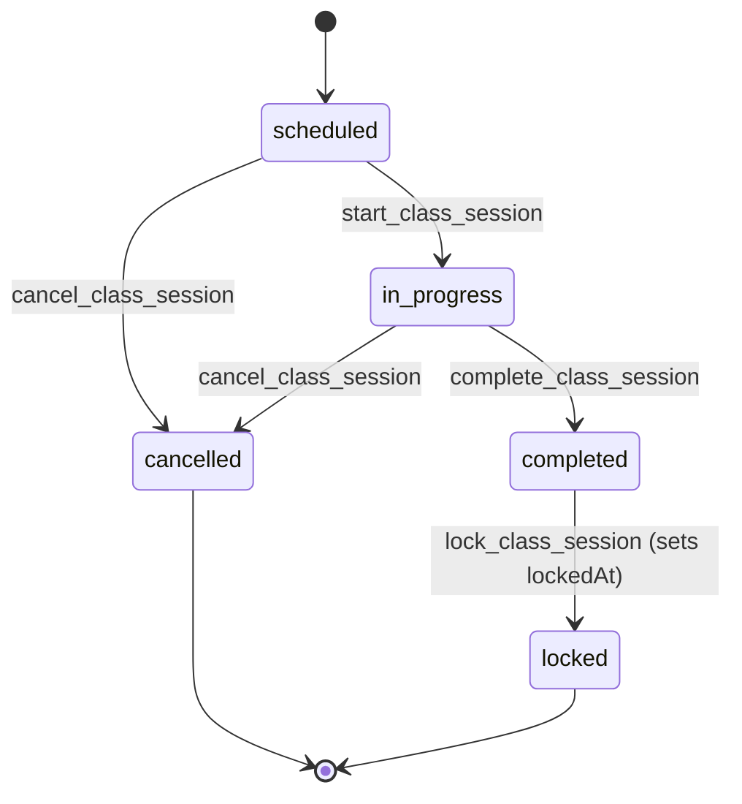

# Workflow contracts: Phases A–E

## Preservation rule

These workflow descriptions capture currently observed behavior. Presentation may change in later waves, but no workflow may gain, lose, or reinterpret a transition, permission check, RPC, validation rule, audit path, or error mapping.

## Students

### Duplicate lookup, create, and update

- Duplicate lookup uses `findStudentFormDuplicatesAction` and `find_student_form_duplicates`; it is available to `students.create` or `students.update` capability holders.
- Creating a student with its primary guardian requires `students.create` and calls `create_student_with_primary_guardian`.
- Updating a student and primary guardian requires `students.update` and calls `update_student_with_primary_guardian`.
- Preconditions, field validation, conflict handling, and duplicate presentation remain in the existing Zod/action/RPC path.
- Create/update revalidate the students directory and relevant student detail/edit paths. The RPC boundary continues to own audit behavior.

### Enrollment lifecycle

| Operation | Preconditions / allowed path | Permission | Existing action / RPC | Forbidden or conflict path | Required regression checks |
| --- | --- | --- | --- | --- | --- |
| Enroll | The existing enrollment form and RPC determine eligible student/class state. | `students.manage_status` | `enrollStudentInClassAction` / `enroll_student_in_class` | Any duplicate, class, enrollment, or status conflict currently returned by the action/RPC. | Same eligible/ineligible choices, same action result, same list/detail revalidation. |
| Transfer | Existing enrollment must be transferable under the RPC rules. | `students.transfer_class` | `transferStudentClassAction` / `transfer_student_class` | Do not offer or permit transitions the current feature/RPC rejects. | Source/destination validation, permission denial, conflict copy, revalidation. |
| Reserve | Existing enrollment must satisfy the current reservation rules. | `students.reserve` | `reserveStudentEnrollmentAction` / `reserve_student_enrollment` | Do not change reasons, status eligibility, or rejected states. | Reservation state, denied case, action result, revalidation. |
| Resume | Existing reservation must satisfy the current resume rules. | `students.reserve` | `resumeStudentEnrollmentAction` / `resume_student_enrollment` | Do not allow resume outside current RPC eligibility. | Resume state, denied case, action result, revalidation. |

The redesign does not define a new enrollment state graph. It must render the feature’s existing read model and action availability.

## Classes

### Create, update, status, schedules

- Create, update, and status actions currently use `classes.create`, respectively calling `create_class`, `update_class`, and `change_class_status`.
- Schedules are feature-owned: create, replace, and end template operations require `classes.manage_schedule` and call `create_class_schedule_template`, `replace_class_schedule_template`, and `end_class_schedule_template`.
- Class create/update/status operations revalidate class list, detail, and edit paths. Schedule operations preserve their current affected-route revalidation.
- The explicitly verified status transitions include `draft → active` and `active → closed`. Any archive or other status transition must remain governed by `change_class_status`; this contract does not infer a broader graph.
- Reasons and confirmation semantics are not centralized. The redesign must preserve each existing feature action’s validation and wording.

### Academic-year context

- Academic-year administration is an existing class-domain surface at `/classes/academic-years`.
- Create, activate, and change status use `classes.create` with `create_academic_year`, `activate_academic_year`, and `change_academic_year_status`.
- Academic year is route/read-model-owned context. It is not global application state, and changes must not be represented as filtering unrelated modules.

### Class regression checks

- Route access remains `classes.view`; action controls remain hidden/disabled according to existing class permissions.
- Create/update/status/schedule payloads and RPC arguments remain unchanged.
- Current status and schedule errors still render as feature-owned errors.
- Academic-year routes, URLs, and existing activation/status behavior remain unchanged.

## Sessions

### Lifecycle

The current `SessionStatus` model is `scheduled`, `in_progress`, `completed`, and `cancelled`. A session becomes locked through `lockedAt`, not a fifth enum value.

- Session create/start/complete/cancel require `sessions.manage` and use `create_class_session`, `start_class_session`, `complete_class_session`, and `cancel_class_session`.
- Cancellation is terminal in the current lifecycle UI. Locked is treated as immutable/terminal in the current UI.
- The current action conflict maps must continue to control timing, lifecycle, validation, and concurrency feedback.
- Schedule-based session preview/materialization uses `dry_run_class_session_generation` and `materialize_class_sessions`. The action code authenticates but has no explicit TypeScript permission check; retain the current RPC/UI contract and do not invent one.
- A migration-defined `reset_unlocked_class_session_before_start` corrective RPC is not an active A–E frontend workflow. Do not surface it as a new UI action.

### Session regression checks

- Route access, session read model, start/complete/cancel action availability, and action payloads are unchanged.
- A scheduled session cannot be presented as started; an in-progress session cannot be presented as completed; a completed session is not presented as locked unless `lockedAt` exists.
- Cancelled and locked surfaces do not expose ordinary lifecycle actions.
- Existing list/detail revalidation and RPC-backed audit behavior remain intact.

## Attendance, results, and lock

### Attendance

- Read access is route/data dependent on `attendance.view`; mutation requires `attendance.mark`.
- `markSessionAttendanceAction` and `updateSessionAttendanceAction` call `mark_session_attendance` and `update_session_attendance`.
- Existing action errors cover at least session-not-started, locked session, cancelled session, roster/enrollment mismatch, and validation failures. These errors remain feature-owned.
- Attendance belongs within the existing session workflow. No standalone attendance route is created.

### Results

- Results display/access is data/route dependent on `results.view`; record/update requires `results.manage`.
- `recordSessionResultAction` and `updateSessionResultAction` call `record_session_result` and `update_session_result`.
- Eligibility, validation, and conflict behavior remain in the existing action/RPC contract. Test score remains optional under that contract. The redesign must not create results for a learner/session outside that contract.

### Lock

- Locking requires `sessions.lock` and calls `lock_class_session` through `lockClassSessionAction`. The server-side lock contract is the readiness source of truth.
- A session may be locked only when the authoritative server-side requirements permit it: the user has `sessions.lock`; the session is completed and not already locked; the lock reason satisfies existing validation; an eligible active roster exists where the RPC requires one; and attendance completeness satisfies the lock RPC.
- Results and test scores are not lock prerequisites. Missing results or optional test scores must not block Lock, and the redesign must not create fake/default results to satisfy Lock.
- Client UI must not independently recreate lock-readiness policy. It may present authoritative supplied state and server-returned failures only.
- `lockedAt` remains the immutable lock marker. Preserve explicit feature-owned confirmation/reason meaning, existing revalidation and audit behavior, and the absence of unlock, reset, reopen, or reversal UI. Neither attendance nor results may be made editable by redesign presentation after lock.

### Ledger consequences

- Regular and makeup session charges remain server/RPC-owned. Existing qualifying attendance produces the current ledger effects; `additional_study` retains its existing different treatment.
- Grading credits remain based on existing recorded-result behavior. The UI must not calculate, infer, or recreate ledger consequences.
- `student_session_ledger_entries.delta_sessions` remains integer. The redesign must not introduce fractional-session behavior.

### Attendance/results/lock regression checks

- Permission-denied UI changes no underlying query/action exposure.
- Attendance and results follow the existing session roster and lifecycle constraints.
- Lock presentation reflects only authoritative server-supplied readiness and returned failures. It must not block on missing results or test scores.
- Lock confirmation remains explicit and descriptive; the feature owns wording and Server Action binding.
- After a lock, the same read model continues to show locked/immutable state after refresh and navigation.
- Ledger consequences remain server/RPC-owned; presentation does not calculate session quantities or introduce fractional values.
