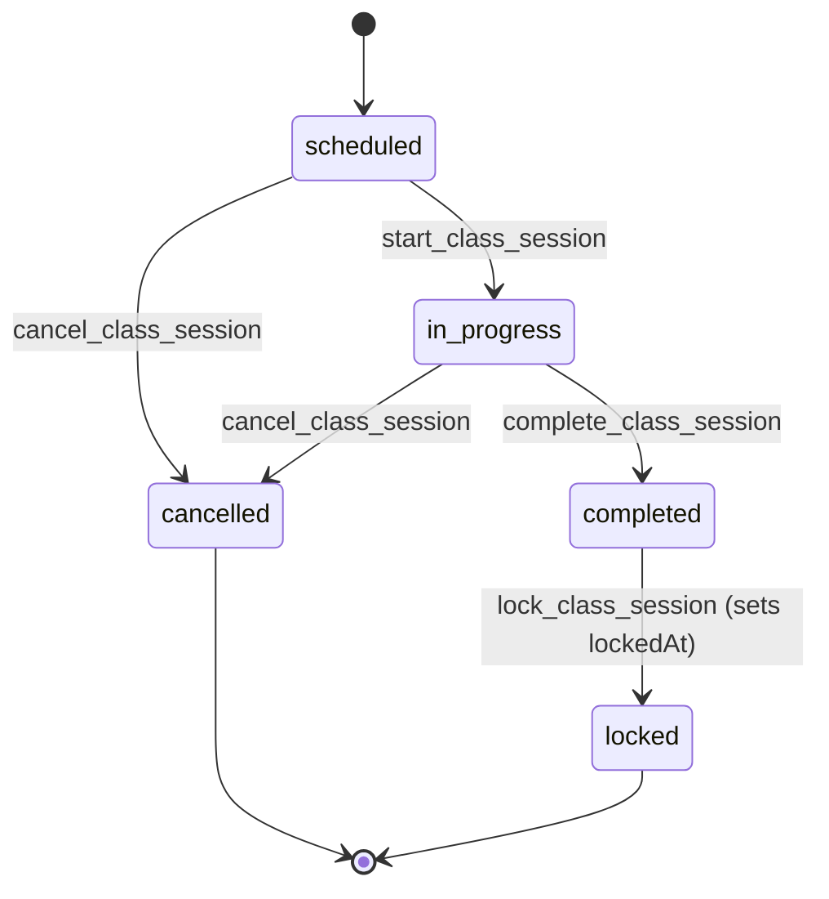

# Workflow contracts: Phases A–E

## Preservation rule

These workflow descriptions capture currently observed behavior. Presentation may change in later waves, but no workflow may gain, lose, or reinterpret a transition, permission check, RPC, validation rule, audit path, or error mapping.

Owner-approved exceptions are recorded next to the workflow they change, each marked with its release: the client lock-readiness mirror (v0.7.0.0, Sessions), and class-page bulk cancel, class-page enrolment and server-side enrolment search (v0.8.0.0, Sessions and Students), class-page transfer and reserve with the expected-enrolment check (v0.9.0.0, Students), the sessions directory's server-side date window with its until-today redirect and the larger list reads (v0.20.0.0, Sessions), the sales-commission list's larger read (v0.22.0.0, List reads outside A–E), and the import wizards' client-side gates (v0.36.0.0, Imports outside A–E).

## Students

### Duplicate lookup, create, and update

- Duplicate lookup uses `findStudentFormDuplicatesAction` and `find_student_form_duplicates`; it is available to `students.create` or `students.update` capability holders.
- Creating a student with its primary guardian requires `students.create` and calls `create_student_with_primary_guardian`.
- Updating a student and primary guardian requires `students.update` and calls `update_student_with_primary_guardian`.
- Preconditions, field validation, conflict handling, and duplicate presentation remain in the existing Zod/action/RPC path.
- Create/update revalidate the students directory and relevant student detail/edit paths. The RPC boundary continues to own audit behavior.

### Enrollment lifecycle

| Operation | Preconditions / allowed path | Permission | Existing action / RPC | Forbidden or conflict path | Required regression checks |
| --- | --- | --- | --- | --- | --- |
| Enroll | The existing enrollment form and RPC determine eligible student/class state. | `students.manage_status` | `enrollStudentInClassAction` / `enroll_student_in_class` | Any duplicate, class, enrollment, or status conflict currently returned by the action/RPC. | Same eligible/ineligible choices, same action result, same list/detail revalidation. |
| Transfer | Existing enrollment must be transferable under the RPC rules. | `students.transfer_class` | `transferStudentClassAction` / `transfer_student_class` | Do not offer or permit transitions the current feature/RPC rejects. | Source/destination validation, permission denial, conflict copy, revalidation. |
| Reserve | Existing enrollment must satisfy the current reservation rules. | `students.reserve` | `reserveStudentEnrollmentAction` / `reserve_student_enrollment` | Do not change reasons, status eligibility, or rejected states. | Reservation state, denied case, action result, revalidation. |
| Resume | Existing reservation must satisfy the current resume rules. | `students.reserve` | `resumeStudentEnrollmentAction` / `resume_student_enrollment` | Do not allow resume outside current RPC eligibility. | Resume state, denied case, action result, revalidation. |

The redesign does not define a new enrollment state graph. It must render the feature’s existing read model and action availability.

Enrolment is also offered from the class page (`/classes/[classId]`, "Ghi danh học sinh"). It calls the same `enrollStudentInClassAction` / `enroll_student_in_class` with the class fixed; preconditions, conflicts and audit are unchanged. The page offers it to viewers with `students.view` and `students.manage_status`. Candidates are students without enrolment history; the dialog ships the first 500 and searches the rest through the Server Action `searchEnrollmentCandidatesAction` (same two permissions, 2–100 characters, read-only `students` query with escaped `ilike` on name and code). PostgREST `ilike` is accent-sensitive, so the dialog merges accentless local matches with the server results. Owner-approved for the Stumana redesign step 5b (v0.8.0.0).

Transfer and reserve are also offered from the class page (`/classes/[classId]`, Học sinh tab, row menu "…") on active classes. They open the student profile's dialogs and call the same `transferStudentClassAction` / `transfer_student_class` and `reserveStudentEnrollmentAction` / `reserve_student_enrollment`; preconditions, conflicts and audit are unchanged. The page offers them to viewers with `students.view` plus `students.transfer_class` or `students.reserve`, on active enrolment rows only, and disables them with a reason when the enrolment starts today or later (the RPCs' date rule) or, for transfer, when no other active class loads. Both actions accept an optional `expectedEnrollmentId`: when given, the action re-reads the student's active enrolment before the RPC and refuses with a reload message if it is a different one. The class roster and the student profile both send it. The RPCs still act on the student's single active enrolment, so the check is action-level only (TODOS). Class-page transfer and reserve are owner-approved for the Stumana redesign step 5b (v0.9.0.0); the expected-enrolment check shipped in the same release.

## Classes

### Create, update, status, schedules

- Create, update, and status actions currently use `classes.create`, respectively calling `create_class`, `update_class`, and `change_class_status`.
- Schedules are feature-owned: create, replace, and end template operations require `classes.manage_schedule` and call `create_class_schedule_template`, `replace_class_schedule_template`, and `end_class_schedule_template`.
- Class create/update/status operations revalidate class list, detail, and edit paths. Schedule operations preserve their current affected-route revalidation.
- The explicitly verified status transitions include `draft → active` and `active → closed`. Any archive or other status transition must remain governed by `change_class_status`; this contract does not infer a broader graph.
- Reasons and confirmation semantics are not centralized. The redesign must preserve each existing feature action’s validation and wording.

### Academic-year context

- Academic-year administration is an existing class-domain surface at `/classes/academic-years`.
- Create, activate, and change status use `classes.create` with `create_academic_year`, `activate_academic_year`, and `change_academic_year_status`.
- Academic year is route/read-model-owned context. It is not global application state, and changes must not be represented as filtering unrelated modules.

### Class regression checks

- Route access remains `classes.view`; action controls remain hidden/disabled according to existing class permissions.
- Create/update/status/schedule payloads and RPC arguments remain unchanged.
- Current status and schedule errors still render as feature-owned errors.
- Academic-year routes, URLs, and existing activation/status behavior remain unchanged.

## Sessions

### Lifecycle

The current `SessionStatus` model is `scheduled`, `in_progress`, `completed`, and `cancelled`. A session becomes locked through `lockedAt`, not a fifth enum value.

- Session create/start/complete/cancel require `sessions.manage` and use `create_class_session`, `start_class_session`, `complete_class_session`, and `cancel_class_session`.
- Cancellation is terminal in the current lifecycle UI. Locked is treated as immutable/terminal in the current UI.
- The current action conflict maps must continue to control timing, lifecycle, validation, and concurrency feedback.
- Schedule-based session preview/materialization uses `dry_run_class_session_generation` and `materialize_class_sessions`. The action code authenticates but has no explicit TypeScript permission check; retain the current RPC/UI contract and do not invent one.
- A migration-defined `reset_unlocked_class_session_before_start` corrective RPC is not an active A–E frontend workflow. Do not surface it as a new UI action.
- Bulk cancel from the class page (`/classes/[classId]`, Buổi học tab) uses the Server Action `cancelClassSessionsAction`. It is owner-only: the action requires both `sessions.manage` and `classes.manage_schedule` (teaching assistants hold only the first). It accepts 1–40 distinct session ids of that class and a 3–500 character reason, and cancels only sessions of the class that are still `scheduled` with `locked_at` null. Each session is re-read just before its RPC, so one started since the page loaded is refused. Every eligible session goes through the same `cancel_class_session` RPC one at a time; a failure does not stop the rest, and the result reports each session. The class page is revalidated once, session routes only when something was cancelled. Select-all takes only upcoming sessions; an overdue session (past its date, never started) is ticked on its own and the confirmation warns that it may have been taught. The owner-only rule and the `in_progress` exclusion are enforced in the action, not yet in the database (TODOS). Owner-approved for the Stumana redesign step 5b (v0.8.0.0).
- The sessions directory (`/sessions`) reads its date range on the server: valid `from`/`to` URL params bound the `class_sessions` query before its 300-row cap (the default stays the newest 300 by date), and the page reports that range to the list, which says when a range or chip reaches past what was read and offers "Tải lại danh sách". Undated "Chờ khóa" (`status=completed&lock=unlocked`) and "Chưa điểm danh" (`attendance=missing`) URLs, such as the stored daily lock-queue digest link, are redirected to the same query plus `to=<Vietnam today>` before any read, since both sets only hold sessions on or before today. Status, lock, class, kind and search stay client filters over the loaded rows. Attendance and result counts are read in 150-id chunks paged past the 1000-row cap; the lock-queue RPC `get_unlocked_completed_sessions` is read with `p_limit` 500 (its maximum) on this page and `get_grading_credits_dashboard` with 500 on `/grading-credits` (the dashboard summary keeps 200). All reads are unchanged RLS-scoped selects and existing RPCs. Owner-approved for the Stumana redesign step 14a (v0.20.0.0).

### Session regression checks

- Route access, session read model, start/complete/cancel action availability, and action payloads are unchanged.
- A scheduled session cannot be presented as started; an in-progress session cannot be presented as completed; a completed session is not presented as locked unless `lockedAt` exists.
- Cancelled and locked surfaces do not expose ordinary lifecycle actions.
- Existing list/detail revalidation and RPC-backed audit behavior remain intact.

## Attendance, results, and lock

### Attendance

- Read access is route/data dependent on `attendance.view`; mutation requires `attendance.mark`.
- `markSessionAttendanceAction` and `updateSessionAttendanceAction` call `mark_session_attendance` and `update_session_attendance`.
- Existing action errors cover at least session-not-started, locked session, cancelled session, roster/enrollment mismatch, and validation failures. These errors remain feature-owned.
- Attendance belongs within the existing session workflow. No standalone attendance route is created.

### Results

- Results display/access is data/route dependent on `results.view`; record/update requires `results.manage`.
- `recordSessionResultAction` and `updateSessionResultAction` call `record_session_result` and `update_session_result`.
- Eligibility, validation, and conflict behavior remain in the existing action/RPC contract. Test score remains optional under that contract. The redesign must not create results for a learner/session outside that contract.

### Lock

- Locking requires `sessions.lock` and calls `lock_class_session` through `lockClassSessionAction`. The server-side lock contract is the readiness source of truth.
- A session may be locked only when the authoritative server-side requirements permit it: the user has `sessions.lock`; the session is completed and not already locked; the lock reason satisfies existing validation; an eligible active roster exists where the RPC requires one; and attendance completeness satisfies the lock RPC.
- Results and test scores are not lock prerequisites. Missing results or optional test scores must not block Lock, and the redesign must not create fake/default results to satisfy Lock.
- Client UI must not invent its own lock-readiness policy. It may mirror the server rule exactly (`src/features/sessions/lock-readiness.ts` mirrors `lock_class_session_internal`: non-empty roster, every roster student present or absent, `additional_study` and walk-ins not counted, results not a condition) to show the condition checklist and to disable Lock with a stated reason while a mirrored condition is unmet. The lock RPC stays authoritative: it re-checks every condition, and its failures are shown as returned. A change to the RPC's rule must update the mirror and its tests in the same change. Owner-approved for the Stumana redesign (v0.7.0.0).
- `lockedAt` remains the immutable lock marker. Preserve explicit feature-owned confirmation/reason meaning, existing revalidation and audit behavior, and the absence of unlock, reset, reopen, or reversal UI. Neither attendance nor results may be made editable by redesign presentation after lock.

### Ledger consequences

- Regular and makeup session charges remain server/RPC-owned. Existing qualifying attendance produces the current ledger effects; `additional_study` retains its existing different treatment.
- Grading credits remain based on existing recorded-result behavior. The UI must not calculate, infer, or recreate ledger consequences.
- `student_session_ledger_entries.delta_sessions` remains integer. The redesign must not introduce fractional-session behavior.

### Attendance/results/lock regression checks

- Permission-denied UI changes no underlying query/action exposure.
- Attendance and results follow the existing session roster and lifecycle constraints.
- Lock presentation reflects only authoritative server-supplied readiness, the exact client mirror of the lock RPC's attendance rule permitted under Lock above, and returned failures. It must not block on missing results or test scores.
- Lock confirmation remains explicit and descriptive; the feature owns wording and Server Action binding.
- After a lock, the same read model continues to show locked/immutable state after refresh and navigation.
- Ledger consequences remain server/RPC-owned; presentation does not calculate session quantities or introduce fractional values.

## List reads outside A–E

- The sales-commission list (`/commissions`) reads `get_sales_commission_accruals_dashboard` with `p_limit` 500 (the RPC's maximum; the loader's default stays 200, the RPC's own default). Month, sale and source filters stay client filters over the loaded rows, and the page says when a selected month may be cut by that cap ("Tháng MM/YYYY có thể chưa đủ…"). Unchanged RPC, RLS scope and permissions (`commissions.view`, `commissions.manage`); no write path. Owner-approved for the Stumana redesign step 14b (v0.22.0.0).

## Imports outside A–E

Server actions, RPCs, validation, parsing, mapping and the typed confirmation phrases are unchanged. Owner-approved client-side gates for the Stumana redesign step 15b (v0.36.0.0):

- Class & schedule import (`/imports/classes`): "Tạo lô" stays disabled while the dry-run reports conflicting or invalid rows ("Còn {n} dòng xung đột hoặc không hợp lệ. Sửa file Excel rồi chọn lại file."). Before, the page called `createClassScheduleImportBatchAction` anyway and the RPC staged a `previewed` batch that could never be committed and used up the file's SHA-256. The server-side fix stays in TODOS.
- Enrollment import (`/imports/enrollments`): the commit needs a batch created on the page in this visit; the hard-coded fallback batch id is gone, and the commit also needs a fresh dry-run with 0 conflicts.
- Session-balance import (`/imports/session-balances`, `/imports/session-balances/[batchId]`): without `imports.session_balances` the page shows the batch list only, and the batch page hides row exclusion and reconciliation. The routes pass their existing permission check; the server actions already required that code.
- All four wizards drop a dry-run answer that arrives after the file, mapping, effective date or academic year changed, so a check never shows as current for inputs it did not run on.
- Student and enrollment imports read an "already committed" refusal as done, not as a failure: the student commit's conflict "File này đã được import thành công trước đó." (`STUDENT_IMPORT_FILE_ALREADY_COMMITTED`) and an enrollment commit error that contains `STUDENT_ENROLLMENT_IMPORT_BATCH_ALREADY_COMMITTED` show an info banner ("File này đã được nhập." / "Lô này đã được ghi danh.") and lock the commit. A retry after a lost answer reaches this refusal when the first attempt wrote. The match uses the server action's message text, which the actions keep unchanged.
